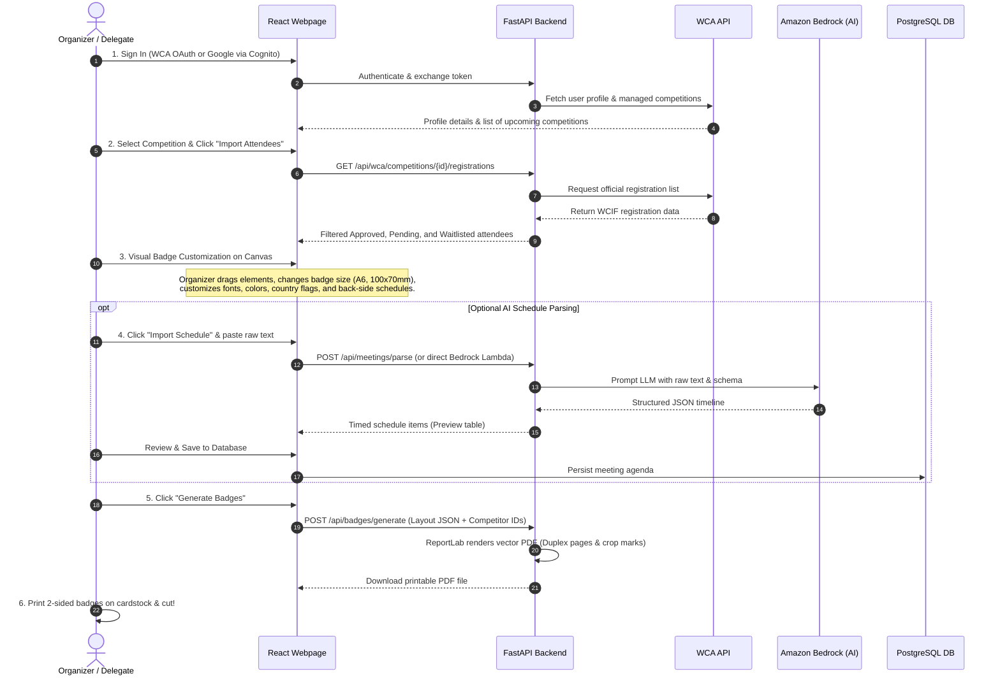
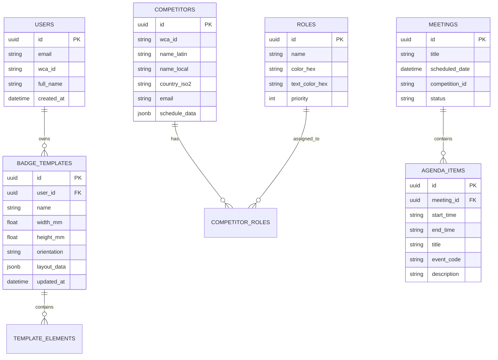

# System Architecture & Technical Documentation: WCA Badge Generator ("spry")

> **Welcome!** If you are new to this project, this document is your guide to understanding how this entire web application is designed, how data flows through it, and how each component works under the hood.

---

## 1. Executive Summary & Purpose

### What is this project?
The **WCA Badge Generator** (code-named `spry`) is a full-stack, cloud-ready web application built for organizers and delegates of the **World Cube Association (WCA)**—the international governing body for Rubik's cube competitions.

### What problem does it solve?
Running a speedcubing competition requires printing physical credentials (badges) for dozens or hundreds of competitors, delegates, organizers, and volunteers.
Each badge needs:
1. **Front Side:** Competitor's name (both Latin and local/Cyrillic scripts), country flag, WCA ID, a scannable QR code linking to their official profile, and role badges (e.g., Organizer, Delegate, Staff, Competitor).
2. **Back Side (Duplex Printing):** The competitor's personalized event schedule, including which rounds they are competing in and which groups they are assigned to judge, scramble, or run.
3. **Automated Agenda Ingestion (AI):** Converting messy, human-written schedules pasted from emails or chats into structured event timetables using LLMs.
4. **Print-Ready Output:** Generating high-resolution, vector-accurate, double-sided (duplex) PDFs with cutting lines on standard paper sheets (A4, Letter) ready for commercial or office printers.

---

## 2. High-Level System Architecture

The project uses a modern **modular monorepo** architecture separating the client, API server, persistent database, asynchronous event-driven pipelines, and cloud services:

```mermaid
flowchart TD
    subgraph Client["Frontend Client (React + Vite + Tailwind)"]
        UI["Web UI: Figma-like Badge Studio"]
        Canvas["Interactive SVG/HTML5 Canvas"]
        AILayout["AI Auto-Layout Vision Framing"]
        AIModal["AI Agenda Parser Modal"]
        WcaAuth["WCA / Cognito Sign-in"]
    end

    subgraph AWSCloudFront["AWS Global CDN & Storage"]
        CF["Amazon CloudFront (CDN)"]
        S3Front["Amazon S3 (Frontend Bucket)"]
    end

    subgraph BackendAPI["Backend API (FastAPI + Python)"]
        Router["FastAPI HTTP Router"]
        PDFGen["ReportLab PDF Generator"]
        CSVParser["WCA CSV / Name Parser"]
        LayoutAI["Multimodal Badge Auto-Layout Engine"]
        AIEngine["AI Agenda Parser Service"]
        ReportEngine["Weekly Analytics Reporter"]
    end

    subgraph Persistence["Database & Storage"]
        Postgres[("PostgreSQL 16 (spry_badges)")]
        Alembic["Alembic Migrations"]
    end

    subgraph External["External Services & APIs"]
        WCA["World Cube Association API (OAuth2 + WCIF)"]
        Gemini["Google Gemini Vision API (gemini-3-flash)"]
        Bedrock["Amazon Bedrock (Claude / Nova)"]
        Cognito["Amazon Cognito (User Pool + Google Federation)"]
        SES["Amazon SES (Email Service)"]
        EventBridge["Amazon EventBridge (Weekly Scheduler)"]
        SQS["Amazon SQS (Report Queues)"]
    end

    UI --> WcaAuth
    UI --> AILayout
    CF --> S3Front
    UI <--> Router
    AILayout <--> LayoutAI
    WcaAuth <--> Cognito
    WcaAuth <--> WCA
    Router <--> Postgres
    Alembic --> Postgres
    Router <--> WCA
    LayoutAI <--> Gemini
    LayoutAI <--> Bedrock
    AIEngine <--> Bedrock
    ReportEngine <--> EventBridge
    ReportEngine <--> SQS
    ReportEngine <--> SES
    Router --> PDFGen
```



### 2.1 Repository & Directory Structure

```text
.
├── backend/                  # FastAPI REST API, ReportLab engine, SQLAlchemy models
├── frontend/                 # React 18 + Vite SPA, Tailwind CSS, Canvas editor
├── infra/                    # CloudFormation IaC (Cognito, Lambda, S3, EventBridge, Bedrock)
├── labs/                     # University lab task sheets, discussion notes & submissions
│   ├── lab3/                 # Lab 3: Stage 2 Serverless Migration & Cognito discussion
│   ├── lab5/                 # Lab 5: Event-Driven Weekly Reports submission
│   └── lab6/                 # Lab 6: Bedrock LLM Agenda Parser task & submission
├── test/                     # Test badge outputs and mock PDF assets
├── .agents/skills/           # Custom agent automation skills (cleaner, docs updater)
├── docker-compose.yml        # Local full-stack container orchestration
├── Makefile                  # Developer CLI commands (lint, test, deploy)
└── ARCHITECTURE.md           # Architecture blueprint and evolution log
```

---

## 3. How the Webpage Works: Newbie Walkthrough

When an organizer opens the webpage in their browser, here is the complete end-to-end journey:



---

## 4. Detailed Component Breakdown

### 4.1 Frontend Layer (`frontend/`)
The frontend is built with **React 18**, **Vite**, **TypeScript**, and styled with **Tailwind CSS** and **Lucide Icons**.

* **`App.tsx`**: Main application shell that holds top-level state: current competitor list, active badge template, zoom level, selected canvas element, front/back flip state, and modal open states.
* **Top Navigation (`src/components/editor/TopNav.tsx`)**:
  * Switches between Front side and Back side of the badge.
  * Shows connected user status (WCA Delegate, Organizer, or Google User).
  * Houses primary call-to-action buttons: `"Generate Badges"` (PDF export) and `"Import Schedule"` (AI Agenda modal).
* **Left Panel (`src/components/editor/LeftPanel.tsx`)**:
  * **WCA Integration:** Live competition selector with category badges (🟢 Approved, 🟡 Pending, 🔴 Cancelled).
  * **Manual Attendee Creation:** Modal to add custom badges for VIPs, parents, or staff not on the WCA roster.
  * **Badge Dimensions:** Standard A6 (`105 x 148 mm`), `100 x 70 mm`, `90 x 70 mm`, or custom dimensions.
  * **Artwork Upload & AI Auto-Layout:** Drag & drop background templates (PNG, JPG, SVG) with one-click **✨ AI Auto-Layout** powered by Multimodal Gemini Vision (with accessible indeterminate spinner, `Cancel` via `AbortController`, and optional layout hint input).
  * **Participant Carousel:** Step through each attendee to preview their live personalized badge.
* **Interactive Canvas (`src/components/editor/Canvas.tsx`)**:
  * Real-time Figma-like WYSIWYG editor with human-in-the-loop AI layout review banner (`Undo`, `Save Layout`, `✨ AI` suggested badges on untouched elements).
  * Precise millimeter-to-screen pixel conversion (`96 DPI` preview, scaled dynamically).
  * Draggable, resizable bounding boxes with transform handles for:
    * Competitor Full Name (with automatic Cyrillic/Latin splitting).
    * Country ISO Flag (loaded from embedded vector assets).
    * WCA ID & 2D QR Code.
    * Custom Role Tags (color-coded badge chips).
    * Competitor Personal Schedule Table (on back side).
* **Right Panel (`src/components/editor/RightPanel.tsx`)**:
  * Context-aware Property Inspector for whichever element is selected on the canvas:
    * `PositionInspector.tsx`: Millimeter coordinates (`x`, `y`, `width`, `height`, rotation, z-index).
    * `TypographyInspector.tsx`: Font family, size, weight, letter spacing, alignment.
    * `AppearanceInspector.tsx`: Background color, border radius, border width, opacity.
    * `RoleInspector.tsx`: Role creation, color picker, and competitor assignment.
* **AI Agenda Modal (`src/components/agenda/PasteAgendaModal.tsx`)**:
  * Text area to paste messy timetables.
  * Communicates with the AI backend service to parse times, titles, descriptions, and venues.
  * Provides an editable tabular preview before saving into the database.

---

### 4.2 Backend Layer (`backend/app/`)
The backend is a high-performance **FastAPI** application structured around clean architectural layers:

```text
backend/app/
├── api/            # HTTP Route Handlers (FastAPI Routers)
│   ├── ai.py           # Multimodal AI badge auto-layout route (POST /api/ai/badge-layout)
│   ├── auth.py         # Cognito & session verification
│   ├── badges.py       # Layout template CRUD (with ai_suggestion tracking) & PDF endpoints
│   ├── competitors.py  # CSV ingestion & attendee management
│   ├── meetings.py     # Meeting agenda CRUD & AI parsing routes
│   ├── roles.py        # Custom roles & styling configurations
│   └── wca.py          # WCA OAuth2 handshake & API proxies
├── ai/             # GenAI Integration (Lab 6)
│   ├── agenda.py       # Amazon Bedrock client & JSON extraction logic
│   ├── agenda_lambda.py# Standalone AWS Lambda handler (Agenda + Badge Auto-Layout)
│   ├── badge_layout.py # Multimodal Gemini Vision / Bedrock badge auto-layout engine
│   ├── cli.py          # Command-line interface for testing agenda parsing
│   └── layout_cli.py   # Command-line interface for testing badge auto-layout
├── core/           # Infrastructure & Application Core
│   ├── config.py       # Pydantic Settings reading environment variables
│   └── database.py     # SQLAlchemy 2.0 async engine & session maker
├── models/         # SQLAlchemy ORM Database Models
│   ├── badge_template.py # Badge layouts, elements, coordinates
│   ├── competitor.py     # Competitor records parsed from CSV / WCA
│   ├── meeting.py        # Meetings & parsed agenda items
│   ├── role.py           # Custom roles & color styling
│   └── user.py           # Authenticated users
├── reports/        # Event-Driven Asynchronous Reporting (Lab 5)
│   ├── weekly.py         # Database query & CSV report generation
│   ├── lambda_handler.py # AWS Lambda entrypoint for EventBridge / SQS
│   └── mailer.py         # Amazon SES email dispatcher with CSV attachments
├── schemas/        # Pydantic Schemas (Contract & Validation Layer)
│   ├── badge.py, competitor.py, meeting.py, role.py, wca.py
└── services/       # Core Business Logic Services
    ├── assignment_pdf_parser.py # Parses group assignments from PDF
    ├── csv_parser.py            # Splits bilingual names and CSV columns
    ├── pdf_generator.py         # High-resolution ReportLab PDF engine
    └── wca_api.py               # Communicates with World Cube Association API
```

---

### 4.3 Database Schema (Entity-Relationship)



---

### 4.4 Cloud & Serverless Infrastructure (`infra/`)

The application can run entirely locally via Docker or in the AWS Cloud using **Serverless Stage 2 Architecture**:

1. **`infra/auth.yml`**: Amazon Cognito User Pool with Hosted UI and Google Identity Provider federation. Issues secure JWT tokens for frontend authentication.
2. **`infra/backend.yml`**: Deploys the FastAPI application containerized on Amazon ECR, running as an AWS Lambda function with Function URL or API Gateway.
3. **`infra/frontend.yml`**: Provisions an Amazon S3 static website bucket fronted by Amazon CloudFront CDN with TLS/SSL encryption and cache invalidation.
4. **`infra/reports.yml` (Lab 5)**: Fully event-driven reporting pipeline:
   * **EventBridge Scheduler:** Triggers every Monday morning at 08:00 UTC.
   * **SQS Queue:** Buffers report trigger jobs.
   * **Report Builder Lambda:** Pulls database statistics, formats a CSV, and writes to an S3 reports bucket.
   * **S3 Event Notification:** S3 upload triggers SQS mail queue.
   * **Report Mailer Lambda:** Fetches CSV from S3 and dispatches email via Amazon SES to stakeholders.
5. **`infra/ai.yml` (Lab 6)**: Standalone AWS Lambda container with IAM permissions to invoke Amazon Bedrock (`anthropic.claude-3-5-sonnet` / `amazon.titan-text-express`), exposed through an authenticated Function URL.

---

## 5. Development & Operations Runbook

### Prerequisites
* Docker & Docker Compose
* Python 3.12+ (or 3.13/3.14)
* Node.js 20+ & npm

### Quick Start (Single Command)
To run the entire stack locally with database health checks and hot reloading:

```bash
docker compose up --build
```

Access the local services:
* **Frontend Web Application:** [http://localhost:5173](http://localhost:5173)
* **Backend Swagger API Docs:** [http://localhost:8000/docs](http://localhost:8000/docs)
* **PostgreSQL Database:** `localhost:5432` (`spry_badges`)

### Useful Make Commands
The `Makefile` standardizes all common operations:

| Command | Action |
| :--- | :--- |
| `make dev` | Build and start all services via Docker Compose |
| `make up` | Start existing containers in background mode (`-d`) |
| `make down` | Stop and remove running containers |
| `make clean` | Stop containers, remove anonymous volumes and orphan containers |
| `make lint` | Run backend linter (`ruff`) and frontend typecheck (`tsc`) |
| `make test` | Run backend test suite (`pytest`) and frontend tests |
| `make aws-deploy-all` | Deploy backend, auth, and frontend to AWS |

---

## 6. Architecture Evolution Log (Changelog)

> [!IMPORTANT]
> **Rule for Future Changes:** Whenever new features, database tables, external integrations, or infrastructure changes are introduced, document them in this table to keep the architectural history up to date.

| Date | Milestone / Lab | Key Changes Introduced | Impacted Components |
| :--- | :--- | :--- | :--- |
| **Oct 2026** | **AI Badge Brand Palette & Typography Matching** | Upgraded AI Badge Auto-Layout (v2) with Pillow median-cut palette extraction, smart typography pairing (Playfair Display, Oswald, Montserrat, JetBrains Mono), brand-tinted contrast preservation, and automatic Role/QR/Avatar styling. | `backend/app/ai/badge_layout.py, backend/app/services/pdf_generator.py, frontend/src/App.tsx, frontend/src/components/editor/Canvas.tsx, frontend/src/components/editor/BadgeRenderer.tsx` |
| **Oct 2026** | **Multimodal AI Badge Auto-Layout** | Added Gemini Vision multimodal badge auto-layout engine with 5x5 luminance contrast safety, LeftPanel trigger with accessible progress spinner and cancel support, Canvas human-in-the-loop review banner with Undo/Save, and PostgreSQL ai_suggestion tracking. | `backend/app/ai/badge_layout.py, backend/app/api/ai.py, frontend/src/components/editor/LeftPanel.tsx, frontend/src/components/editor/Canvas.tsx, docs/adr/0007-ai-badge-auto-layout.md` |
| **Oct 2026** | **Auth Provider Specific Icons** | Updated TopNav and WcaProfileModal to display distinct icons for Email authentication (Mail envelope icon) versus Google authentication (Google G logo) across avatar badges and provider tags. | `frontend/src/components/editor/TopNav.tsx, frontend/src/components/wca/WcaProfileModal.tsx` |
| **Oct 2026** | **Frontend Custom Account Distinction** | Enhanced frontend presentation for registered accounts (Cognito email/password vs Google OAuth), adding custom initials avatars, verified account badges, separate profile cards, and unified WCA profile linking. | `frontend/src/components/editor/TopNav.tsx, frontend/src/components/wca/WcaProfileModal.tsx, frontend/src/types/wca.ts` |
| **Oct 2026** | **Lab Files Structuring** | Organized all lab-specific task sheets, discussion notes, and submission reports into dedicated subdirectories (labs/lab3, labs/lab5, labs/lab6) with a unified lab index. | `labs/` |
| **Sep 2026** | **Lab 1: Monorepo Foundation** | Initial monorepo setup: FastAPI backend, PostgreSQL 16 with Alembic, React + Vite frontend, and ReportLab PDF generator. | `backend/`, `frontend/`, `docker-compose.yml` |
| **Oct 2026** | **Lab 2: AWS Deployment** | Dockerized backend and frontend deployment on AWS infrastructure with CI/CD GitHub Actions. | `.github/workflows/`, `Makefile` |
| **Oct 2026** | **Lab 3: Serverless Stage 2** | Migrated backend to AWS Lambda with Function URL, Amazon ECR container packaging, and S3/CloudFront frontend hosting. | `infra/backend.yml`, `infra/frontend.yml` |
| **Oct 2026** | **Lab 4: Cognito Auth** | Integrated Amazon Cognito User Pool with Hosted UI and Google Identity Provider federation. | `infra/auth.yml`, `backend/app/api/auth.py` |
| **Oct 2026** | **Lab 5: Event-Driven Reports** | Added automated weekly CSV report generation using EventBridge Scheduler, SQS, Lambda, S3, and Amazon SES email dispatch. | `backend/app/reports/`, `infra/reports.yml` |
| **Oct 2026** | **Lab 6: GenAI Agenda Parser** | Integrated Amazon Bedrock LLM to parse natural-language meeting/competition agendas into structured JSON with an interactive UI modal. | `backend/app/ai/`, `frontend/src/components/agenda/`, `infra/ai.yml` |
| **Oct 2026** | **Maintenance & Housekeeping** | Cleaned project workspace, deleted unused artifacts/caches, unified documentation, and created automated maintenance skills. | `ARCHITECTURE.md`, `.agents/skills/` |
