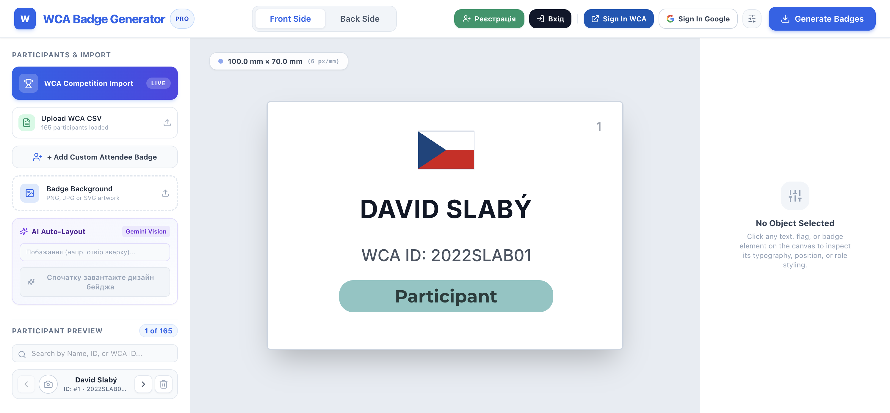
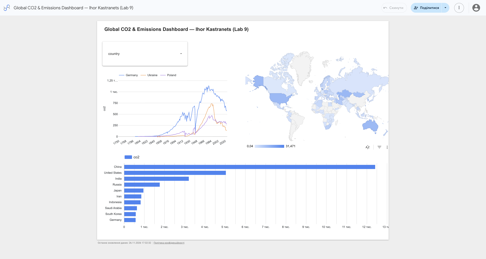

# Lab 9: One project, two clouds: Spry on Google Cloud ☁️☁️
## Multi-Cloud Architecture, Cost Comparison & Data/AI Lab Submission

> **Route Taken:** **I took the no-GCP-account route (without creating a Google Cloud billing account or attaching a credit card)**, following the official *"What you submit (in case no GCP account)"* instructions.

**Student:** Ihor Kastranets (`kastranets.pn@ucu.edu.ua`)  
**Course:** Object-Oriented Analysis and Design (OOAD)  
**Repository:** [`IhorKastranetsUCU/WCA_badges`](https://github.com/IhorKastranetsUCU/WCA_badges)

---

## 1. `gcp/` Terraform Configuration & ADR (`docs/adr/`)

- **GitHub Commit (Terraform `gcp/`, ADR 0009, Firebase Hosting config, and Cloud Run container portability):**  
  **[https://github.com/IhorKastranetsUCU/WCA_badges/commit/80f593560a97d4b2c5de8b2228c9c23bacb5bea5](https://github.com/IhorKastranetsUCU/WCA_badges/commit/80f593560a97d4b2c5de8b2228c9c23bacb5bea5)**
- **Architecture Decision Record:** [`docs/adr/0009-gcp-multicloud-architecture.md`](docs/adr/0009-gcp-multicloud-architecture.md)
  - Documents the full AWS-to-GCP service mapping table (`Firebase Hosting`, `Cloud Run`, `Artifact Registry`, `Cloud SQL db-f1-micro` vs `Firestore`, `Secret Manager`, `Cloud Logging`, `Service Accounts + Workload Identity Federation`), database latency/cost/code trade-offs, email strategy (keep Amazon SES on AWS; Secret Manager if moved to SendGrid/Resend), and subsystems intentionally kept on AWS (Cognito Auth, Weekly Reports, Bedrock AI Agenda Parser).
- **Isolated `gcp/` Terraform Root Module:**
  - `gcp/versions.tf`, `gcp/variables.tf`, `gcp/terraform.tfvars`, `gcp/apis.tf`, `gcp/iam.tf`, `gcp/database.tf`, `gcp/cloud_run.tf`, `gcp/outputs.tf`, `gcp/.terraform.lock.hcl`
  - Separate state from AWS `infra/`; uses a dedicated `spry-api-runtime` service account (no default compute SA, no JSON keys) and optional keyless GitHub OIDC Workload Identity Federation using numeric `repository_owner_id` and `repository_id`.

### Output of `terraform init` and `terraform validate` in `gcp/`

```text
Initializing the backend...

Initializing provider plugins...
- Finding hashicorp/google versions matching "~> 6.0"...
- Finding hashicorp/random versions matching "~> 3.6"...
- Installing hashicorp/random v3.9.1...
- Installed hashicorp/random v3.9.1 (signed by HashiCorp)
- Installing hashicorp/google v6.50.0...
- Installed hashicorp/google v6.50.0 (signed by HashiCorp)

Terraform has created a lock file .terraform.lock.hcl to record the provider
selections it made above. Include this file in your version control repository
so that Terraform can guarantee to make the same selections by default when
you run "terraform init" in the future.

Terraform has been successfully initialized!

You may now begin working with Terraform. Try running "terraform plan" to see
any changes that are required for your infrastructure. All Terraform commands
should now work.

If you ever set or change modules or backend configuration for Terraform,
rerun this command to reinitialize your working directory. If you forget, other
commands will detect it and remind you to do so if necessary.
Success! The configuration is valid.
```

---

## 2. Cloud Run-Ready Backend Running Locally Next to PostgreSQL

- **Container Portability Changes:**
  - Updated [`backend/Dockerfile`](backend/Dockerfile) to expose `PORT=8080` and run `uvicorn app.main:app --host 0.0.0.0 --port ${PORT:-8080}` directly without any AWS Lambda/Mangum adapter.
  - Updated [`backend/app/core/config.py`](backend/app/core/config.py) to support Cloud SQL Unix sockets (`CLOUD_SQL_CONNECTION_NAME` + `DB_PASSWORD` from Secret Manager) alongside standard `DATABASE_URL`.
  - Added [`firebase.json`](firebase.json) with `/api/**` rewrite to Cloud Run (`wca-badges-api`) and updated [`README.md`](README.md) with deployment, local run, and database stop/destroy instructions.
- **Local Verification (`docker run -e PORT=8080 -p 8080:8080 ...` + `spry_postgres`):**
  - Frontend (`http://127.0.0.1:5173/`, built with `VITE_API_BASE_URL=http://localhost:8080`) loaded **`165 participants loaded`** (`David Slabý`, `WCA ID: 2022SLAB01`, `CZ`) from PostgreSQL via the Cloud Run container:
    - `GET http://localhost:8080/api/roles` → `200 OK` (`server: uvicorn`)
    - `GET http://localhost:8080/api/competitors` → `200 OK` (`server: uvicorn`, 165 competitor rows)
- **Screenshot:** [`labs/lab9/cloudrun_local_frontend_db.png`](labs/lab9/cloudrun_local_frontend_db.png)



---

## 3. Part 3 — Multi-Cloud Cost Comparison (AWS `us-east-1` vs Google Cloud `us-central1`)

**Baseline & Free-Tier Assumptions (USD on-demand list prices, 730 hours/month, excluding tax):**
- **AWS (Lab 4, Stage 2):** S3 + CloudFront Free plan (`$0`), AWS Lambda (`1M` requests & `400,000 GB-s/mo` free → `$0`), Aurora Serverless v2 (`0–1 ACU`, auto-pauses after 5 min idle; `$0.12/ACU-hr` → `$0.06/hr` at `0.5 ACU`), ~`1 GB` DB storage (`$0.10/GB-mo`), ECR + SSM/Logs (`~$0.20/mo`).
- **Google Cloud (Lab 9):** Firebase Hosting Spark free plan (`10 GB` stored, `360 MB/day` egress → `$0`), Cloud Run request-based billing (`2M` requests, `180,000 vCPU-s`, `360,000 GiB-s` free/mo → `$0` under demo traffic; `min_instance_count = 0`), Artifact Registry (`0.5 GB` free → `$0`), Secret Manager (`6` active versions free → `$0`), Cloud Logging (`50 GiB/mo` free → `$0`).
- **GCP Database Variants:**
  - *Cloud SQL `db-f1-micro` (24/7):* `$0.0105/hr` compute + `10 GB` SSD @ `$0.17/GB-mo` (`$1.70/mo`).
  - *Cloud SQL `db-f1-micro` (stopped when idle):* `$0.0105/hr` active only + `$1.70/mo` SSD storage (billed while stopped).
  - *Firestore (NoSQL alternative):* `50k` reads/day, `20k` writes/day, `20k` deletes/day, `1 GiB` free/day; `$0.03` per `100k` extra reads.

### Reference: Nobody Using It for a Month (`0` active hours)

| Piece | AWS (`us-east-1`, Lab 4 Stage 2) | GCP (`us-central1`, Cloud SQL running) | GCP (`us-central1`, Cloud SQL stopped) | GCP (`us-central1`, Firestore) |
|---|---:|---:|---:|---:|
| **Frontend + CDN + HTTPS** | CloudFront Free + S3 (`$0.00`) | Firebase Hosting Free (`$0.00`) | Firebase Hosting Free (`$0.00`) | Firebase Hosting Free (`$0.00`) |
| **API Compute** | Lambda idle (`$0.00`) | Cloud Run `min=0` idle (`$0.00`) | Cloud Run `min=0` idle (`$0.00`) | Cloud Run `min=0` idle (`$0.00`) |
| **Database Compute** | Aurora paused (`$0.00`) | Cloud SQL `db-f1-micro` 730h (`$7.67`) | Cloud SQL stopped (`$0.00`) | Firestore serverless (`$0.00`) |
| **Database Storage** | ~1 GB @ `$0.10/GB` (`$0.10`) | 10 GB SSD @ `$0.17/GB` (`$1.70`) | 10 GB SSD @ `$0.17/GB` (`$1.70`) | <1 GiB free tier (`$0.00`) |
| **Registry, Secrets, Logs** | ECR + SSM + CloudWatch (`~$0.20`) | Within free tier (`$0.00`) | Within free tier (`$0.00`) | Within free tier (`$0.00`) |
| **Total / month** | **~$0.30** | **~$9.37** | **~$1.70** | **$0.00** |

### Four Traffic Profiles

| Traffic Profile | Active DB Hours / Mo | AWS (`us-east-1`, Aurora 0.5 ACU) | GCP (Cloud SQL `db-f1-micro` 24/7) | GCP (Cloud SQL stopped idle) | GCP (Firestore) | Cheaper Cloud & Deciding Line |
|---|---:|---:|---:|---:|---:|---|
| **1. Nobody** | `0 h` | **$0.30** | `$9.37` | `$1.70` | `$0.00` | **AWS** beats Cloud SQL via Aurora auto-pause + 1 GB storage; **Firestore** wins at `$0.00` |
| **2. Class demos (`10 × 2 h`)** | `20 h` (`~20.8 h` w/ 5m tail) | **$1.55** | `$9.37` | `$1.91` | `$0.00` | **AWS** slightly cheaper than stopped Cloud SQL (`$1.55` vs `$1.91`) due to Cloud SQL's `10 GB` SSD minimum (`$1.70`); **Firestore** `$0.00` |
| **3. Office hours (`8 h × 22 d`)** | `176 h` (`~177.8 h` w/ 5m tail) | `$10.97` | **`$9.37`** | **`$3.55`** | `$0.00` | **GCP** wins — Aurora's `$0.06/hr` crosses `db-f1-micro`'s flat `$7.67` around `~128 h/mo` |
| **4. Busy around the clock** | `730 h` | `$44.10` (0.5 ACU) – `$87.90` (1.0 ACU) | **`$9.37`** (API ≤2M req) | **`$9.37`** | `$0.00`–`$1.35` | **GCP** wins decisively because `db-f1-micro` caps compute at `$7.67/mo` |

*(Full calculation breakdown in [`labs/lab9/PART3_COST_TABLE.md`](labs/lab9/PART3_COST_TABLE.md).)*

### Part 3 Questions
1. **Which cloud is cheaper for each profile, and which single line decides it?**  
   The **database** line decides every profile (Frontend, API within free tiers, and Registry/Secrets/Logs are `$0`–`$0.20`). At low usage (*Nobody* and *Class demos*), AWS (`$0.30` and `$1.55`) beats Cloud SQL (`$9.37` 24/7 or `$1.70`/`$1.91` stopped) because Aurora auto-pauses and charges only ~`1 GB` instead of Cloud SQL's `10 GB` SSD floor; only rewriting to Firestore (`$0.00`) is cheaper. Above ~128 active hours/month (*Office hours* and *Busy 24/7*), GCP Cloud SQL (`$3.55–$9.37`) becomes substantially cheaper than Aurora (`$10.97–$87.90`).
2. **Where is the equivalent cost trap on the GCP side (like Aurora kept awake on AWS)?**  
   (a) **Cloud SQL idle/tier creep:** Cloud SQL never auto-pauses, so leaving `db-f1-micro` running bills `$9.37/mo` for 0 users, picking `db-g1-small` or `REGIONAL` HA jumps to `$27–$55+/mo`, and even a stopped instance still bills `$1.70/mo` for its SSD until deleted; (b) **Cloud Run `min_instance_count >= 1` or `cpu_idle = false`**, which turns off scale-to-zero; and (c) **Firestore unbounded list reads**, where reading 500 docs per page load exhausts the `50,000` daily free reads in 100 visits.

---

## 4. Part 4 — Colab Notebook & Looker Studio (Without a GCP Bill)

### A. Colab Notebook (`Lab 9. Part 4 without a Google Cloud bill`)
- **Public Shared Link (Anyone with the link can view, outputs saved):**  
  **[https://colab.research.google.com/drive/1Vi2JKzh-Ov64d_t9Ytmjt8RpiA9fQjhC?usp=sharing](https://colab.research.google.com/drive/1Vi2JKzh-Ov64d_t9Ytmjt8RpiA9fQjhC?usp=sharing)**
- **Execution Hardware & Status:** Executed end-to-end via `Runtime -> Restart session and run all` with zero errors on a free **Tesla T4 GPU** runtime (`100% GPU` via Ollama `qwen3-vl:2b-instruct`).
  - **1. DuckDB SQL (instead of BigQuery):** Aggregated 24 hourly buckets (`hour 0–23`, trips & average fare) over the public dataset.
  - **2. Tesseract & EasyOCR (instead of Vision API):** Extracted Ukrainian/English receipt text (`23 words, mean confidence 95%` in Tesseract; per-word confidence boxes in EasyOCR).
  - **3. Document Parsing (`qwen3-vl:2b-instruct`):** Converted scanned invoice image to structured Markdown in **3 s**.
  - **4. Form Parser (`qwen3-vl:2b-instruct` JSON extraction):**
    - **A (Markdown input):** **8/9 fields matched** in **3 s** (`seller` differed by 1 character: `Kozelnyska` vs `Kozelnytska`).
    - **B (Image input):** **8/9 fields matched** in **3 s** (`seller` differed by 1 character: `Kozelnyska` vs `Kozelnytska`).

### B. Looker Studio Public Dashboard (`owid-co2-data.csv`)
- **Dashboard Link:**  
  **[https://lookerstudio.google.com/reporting/00f6b50a-eb69-4ed4-aec3-3a7e33aca8cb/page/rTREG](https://lookerstudio.google.com/reporting/00f6b50a-eb69-4ed4-aec3-3a7e33aca8cb/page/rTREG)**
- **4 Required Elements Included:**
  1. **Control:** `country` drop-down filter control.
  2. **Line Chart:** `co2` over `year` (1750–2025) comparing **Germany**, **Ukraine**, and **Poland**.
  3. **Geo Chart:** World map of `co2_per_capita` by `iso_code` filtered to `year = 2025` and `iso_code` matching `^[A-Z]{3}$`.
  4. **Top-10 Bar Chart:** `co2` by `country` for `year = 2025` excluding aggregates (`^[A-Z]{3}$`, no `__OTHERS__` group): China, United States, India, Russia, Japan, Iran, Indonesia, Saudi Arabia, South Korea, Germany.
- **Screenshot:** [`labs/lab9/looker_studio_co2_dashboard.png`](labs/lab9/looker_studio_co2_dashboard.png)



### C. Required Three Sentences (Part 4 Reflection)
1. Both the Markdown input (A) and the image input (B) achieved the exact same **8/9** score (`Kozelnyska` vs `Kozelnytska` was the single-character error inherited from the scan reading), though the Markdown pipeline is generally easier to validate, debug, and cheaply re-prompt on text-heavy invoices while direct image input helps when visual layout, stamps, or checkboxes are lost in Markdown conversion.
2. Running on Google Colab's free **Tesla T4 GPU** runtime (`100% GPU` in Ollama with `qwen3-vl:2b-instruct`), Section 4 (image to Markdown) took **3 s** and Section 5 (JSON extraction) took **3 s** for Markdown and **3 s** for the image.
3. I would pay for **Document AI** ($1.50/1,000 OCR pages, $30/1,000 Form Parser pages) instead of a small self-hosted VLM when an application needs predictable enterprise SLAs, exact bounding-box coordinates and checkbox/table geometry, or high accuracy on noisy scans, handwriting, and complex multi-page forms without maintaining GPU servers.

### D. Link to Lab 8 (AWS Data Stack vs GCP Data Stack)
In Lab 8 we processed payment webhooks with **AWS Glue / Athena / QuickSight** over S3. On Google Cloud, **BigQuery** replaces Athena (serverless SQL over columnar storage with 1 TiB/month free), **Dataflow** replaces AWS Glue ETL / Managed Flink (unified Apache Beam batch and streaming), and **Looker Studio** replaces QuickSight for free dashboards—eliminating Glue crawler/partition management and Spark cluster tuning while paying per bytes scanned (or flat slots) in BigQuery.
